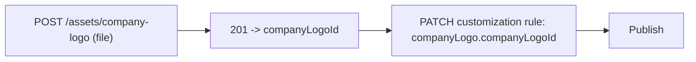

**Assets** are the files that back the Prisma Browser branding, network configuration, and user-facing content: a company logo, a browser icon, a new-tab background image, a PAC (proxy auto-configuration) file, an End User License Agreement (EULA) body, and web app icons. You upload a file once, the API stores it and returns a short **asset ID**, and you then reference that ID from a [customization rule](/prisma-browser/guide/customization-rules) control. The flow is always two steps: **upload the file, then reference the returned ID from a control**.

Assets are the only multipart (file) uploads in the API. Every other call is JSON.

**On this page:** asset types, upload-then-reference flow, limits and validation, endpoint reference, tips, examples.

---

## Asset types

Each asset has its own upload endpoint and returns one ID field. That ID is what you set on the matching customization control.

| Asset | Upload endpoint | Max size | Allowed files | Returns | Referenced by control |
|---|---|---|---|---|---|
| Company logo | `POST /assets/company-logo` | 1 MB | `.png` | `companyLogoId` | `companyLogo` (`companyLogoId`) |
| Browser icon | `POST /assets/browser-icon` | 3 MB | `.png` | `browserIconId` | `browserIcon` (`browserIconId`) |
| Background image | `POST /assets/background-image` | 3 MB | `.png`, `.svg`, `.jpg`, `.jpeg` | `backgroundImageId` | `backgroundImage` (`backgroundImageId`) |
| PAC file | `POST /assets/pac-file` | 2 MB | `.pac`, `.dat`, `.js`, or no extension | `pacFileId` | `proxyAutoConfigurationPacFile` (`pacFileId`) |
| EULA body (preview) | `POST /assets/eula` | 2 MB | `.html`, `.htm` | `eulaId` | `eula` (`contentId`) |
| Web app icon | `POST /assets/web-app-icon` | 200 KB | `.png`, `.jpg`, `.jpeg`, `.gif` | `webAppIconId` | `webAppForceList` (`webApps[].webAppIcon.webAppIconId`) |

The EULA upload is a [preview feature](/prisma-browser/guide/preview-features): send `-H "x-prisma-browser-preview: eula-upload"`, otherwise the request is rejected with `400`.

---

## How the upload-then-reference flow works



1. **Upload** the file with a `multipart/form-data` request whose single `file` part is the binary.
2. **Capture** the returned ID (for example `companyLogoId`).
3. **Reference** it from a customization rule control (for example the `companyLogo` control).
4. **Publish** to make it live. Like all writes, the upload and the control change land in the [draft](/prisma-browser/guide/draft-and-publish) first.

The upload response is intentionally minimal: only the ID you reference.

```json
{ "companyLogoId": "7c1e2f4a-3b5d-4e6f-8a9b-0c1d2e3f4a5b.png" }
```

---

## Limits and validation

| Asset | Max size | Allowed files | Notes |
|---|---|---|---|
| Company logo | 1 MB | `.png` | Up to 600 px wide. SVG must be uploaded from Strata Cloud Manager |
| Browser icon | 3 MB | `.png` | |
| Background image | 3 MB | `.png`, `.svg`, `.jpg`, `.jpeg` | SVG is sanitized |
| PAC file | 2 MB | `.pac`, `.dat`, `.js`, extensionless | |
| EULA body | 2 MB | `.html`, `.htm` | The HTML is sanitized before storage |
| Web app icon | 200 KB | `.png`, `.jpg`, `.jpeg`, `.gif` | A `.jpg` is stored as `.jpeg`. SVG, WebP, and ICO are not accepted |

An upload over the size limit returns `413`. For every entity limit in one place, see [Uploaded assets](/prisma-browser/guide/entity-limits#uploaded-assets) in Entity limits.

---

## Endpoint reference

| Method | Path | Purpose |
|---|---|---|
| `POST` | `/assets/company-logo` | Upload a company logo, returns `companyLogoId` |
| `POST` | `/assets/browser-icon` | Upload a browser icon, returns `browserIconId` |
| `POST` | `/assets/background-image` | Upload a background image, returns `backgroundImageId` |
| `POST` | `/assets/pac-file` | Upload a PAC file, returns `pacFileId` |
| `POST` | `/assets/eula` | Upload a EULA body (preview), returns `eulaId` |
| `POST` | `/assets/web-app-icon` | Upload a web app icon, returns `webAppIconId` |

All paths are under the `/seb-api/v1` base.

---

## Tips and gotchas


:::caution
**Validation errors.** A wrong extension or a failed validation returns `400` with the standard error object (`{ "error": { "code", "message", "timestamp" } }`). A file over the size limit returns `413`. A caller without permission to change configuration gets `403`, and a tenant over its request rate gets `429` (see [Errors](/prisma-browser/guide/errors)).
:::

:::note
**An upload edits the draft.** Publish to make it live (see [Draft and publish](/prisma-browser/guide/draft-and-publish)).
:::

---

## Examples

Expand an example to see the request, response, and the control that references the returned ID.

:::note
Asset uploads are the exception to the usual rule of not printing a create response: the response is a single ID field, shown in each example because you need the exact field name to reference the asset.
:::

<details>
<summary>Upload a company logo and use it in a rule</summary>

Upload the PNG, then set the returned ID on the `companyLogo` control of a customization rule. See [Customization rules](/prisma-browser/guide/customization-rules) for the full control catalog.

**Step 1: upload the file**

```bash
curl -sS -X POST "$PB_API_BASE/assets/company-logo" \
  -H "Authorization: Bearer $PB_TOKEN" \
  -F "file=@./company-logo.png"
```

Response (`201 Created`):

```json
{ "companyLogoId": "7c1e2f4a-3b5d-4e6f-8a9b-0c1d2e3f4a5b.png" }
```

**Step 2: reference the ID on a customization rule**

```bash
curl -sS -X PATCH "$PB_API_BASE/policy/customization/rules/$RULE_ID" \
  -H "Authorization: Bearer $PB_TOKEN" \
  -H "Content-Type: application/json" \
  -d '{
        "controls": {
          "companyLogo": { "mode": "setCompanyLogo", "companyLogoId": "7c1e2f4a-3b5d-4e6f-8a9b-0c1d2e3f4a5b.png" }
        }
      }'
```

Response (`200`):

```json
{ "id": "0RL01CUSTOMIZATIONXXXXXXXXXXX" }
```

</details>

<details>
<summary>Upload a browser icon</summary>

```bash
curl -sS -X POST "$PB_API_BASE/assets/browser-icon" \
  -H "Authorization: Bearer $PB_TOKEN" \
  -F "file=@./browser-icon.png"
```

Response (`201 Created`):

```json
{ "browserIconId": "2d4f6a8c-1e3b-4c5d-9e7f-a1b2c3d4e5f6.png" }
```

Reference it with the `browserIcon` control (`mode: "setBrowserIcon"`, `browserIconId`).

</details>

<details>
<summary>Upload a new-tab background image</summary>

Background images accept `.png`, `.svg`, `.jpg`, and `.jpeg` (SVG is sanitized on upload).

```bash
curl -sS -X POST "$PB_API_BASE/assets/background-image" \
  -H "Authorization: Bearer $PB_TOKEN" \
  -F "file=@./background.jpg"
```

Response (`201 Created`):

```json
{ "backgroundImageId": "9e8d7c6b-5a4f-4e3d-8c2b-1a0f9e8d7c6b.png" }
```

Reference it with the `backgroundImage` control (`mode: "setImage"`, `backgroundImageId`).

</details>

<details>
<summary>Upload a PAC file</summary>

```bash
curl -sS -X POST "$PB_API_BASE/assets/pac-file" \
  -H "Authorization: Bearer $PB_TOKEN" \
  -F "file=@./proxy.pac"
```

Response (`201 Created`):

```json
{ "pacFileId": "4a5b6c7d-8e9f-4a1b-9c2d-3e4f5a6b7c8d" }
```

Reference it with the `proxyAutoConfigurationPacFile` control (`pacFileId`).

</details>

<details>
<summary>Upload a EULA and require users to accept it</summary>

The EULA body is an HTML file. The upload is in preview, so it needs the preview header.

**Step 1: upload the HTML**

```bash
curl -sS -X POST "$PB_API_BASE/assets/eula" \
  -H "Authorization: Bearer $PB_TOKEN" \
  -H "x-prisma-browser-preview: eula-upload" \
  -F "file=@./eula.html"
```

Response (`201 Created`):

```json
{ "eulaId": "3f2b8c1e-7a4d-4e9b-9c21-5d6f0a1b2c3d.html" }
```

**Step 2: set it as `contentId` on the `eula` control**

`title` and `contentId` are required when `enabled` is `true`.

```bash
curl -sS -X PATCH "$PB_API_BASE/policy/customization/rules/$RULE_ID" \
  -H "Authorization: Bearer $PB_TOKEN" \
  -H "Content-Type: application/json" \
  -d '{
        "controls": {
          "eula": {
            "enabled": true,
            "title": "Acceptable use agreement",
            "contentId": "3f2b8c1e-7a4d-4e9b-9c21-5d6f0a1b2c3d.html"
          }
        }
      }'
```

</details>

<details>
<summary>Upload a web app icon</summary>

```bash
curl -sS -X POST "$PB_API_BASE/assets/web-app-icon" \
  -H "Authorization: Bearer $PB_TOKEN" \
  -F "file=@./timesheets-icon.png"
```

Response (`201 Created`):

```json
{ "webAppIconId": "5b6c7d8e-9f0a-4b1c-8d2e-3f4a5b6c7d8e.png" }
```

Reference it from an entry of the `webAppForceList` control as `webAppIcon.webAppIconId`. See [Customization rules](/prisma-browser/guide/customization-rules) (example "Force-install web apps").

</details>

---

## Related

- Policy: [Customization rules](/prisma-browser/guide/customization-rules) (the controls that reference these assets)
- Concepts: [Draft and publish](/prisma-browser/guide/draft-and-publish)
